# Arquitetura Atual do Sistema — Home Assistant & Dashboard Casa

Data do Mapeamento: 15/09/2026  
Versão da Arquitetura: 2.0 (Transição para Painel Dedicado Next.js)

---

## 1. Topologia Geral do Sistema

A residência opera sob um modelo híbrido local-nuvem com processamento primário centralizado no computador host (Windows 11) executando Docker Desktop (WSL2):

```mermaid
graph TD
    subgraph Dispositivos Físicos na Residência
        TuyaDev["Interruptores & Lâmpadas Tuya (LAN/Cloud)"]
        SonoffDev["Fita LED Escritório Sonoff (LAN/Cloud)"]
        XiaomiDev["Luminária Bedside & Robô Dreame (MIoT/Cloud)"]
        SamsungDev["Smart TV Samsung 65' (LAN)"]
        PS5Dev["PlayStation 5 (LAN)"]
        SensDev["Sensores Zigbee/BLE/Tuya (Movimento/Porta/Temp)"]
        AppleDev["Apple Watch / iPhone (Tailscale/Webhook)"]
    end

    subgraph Host Windows 11 / Docker Desktop
        subgraph Docker Network casa-net
            HA["Home Assistant Core 2026.9 (:8123)"]
            MASS["Music Assistant Server 2.10.2 (:8095)"]
            BGUTIL["bgutil-provider (:4416)"]
            ANISETTE["Anisette Server (:6969)"]
        end

        subgraph Host Windows Native Processes
            GLANCES["Glances Web Server (:61208)"]
            DASH_SRV["Dashboard Next.js Server (:3002)"]
            WATCHDOG["Watchdog PowerShell (iniciar_servidor_background.ps1)"]
        end

        DB[("SQLite Database home-assistant_v2.db")]
        HA --> DB
    end

    subgraph Clientes / Interfaces
        TABLET["Tablet de Parede (Navegador Kiosk / Standby)"]
        MOBILE["Smartphones dos Moradores (Tailscale / LAN)"]
        ADMIN["Lovelace Admin Home Assistant (:8123)"]
    end

    TuyaDev <-->|UDP 6666 / Cloud API| HA
    SonoffDev <-->|Local LAN / Cloud| HA
    XiaomiDev <-->|MIoT Protocol / Cloud| HA
    SamsungDev <-->|TCP Local / SmartThings Cloud| HA
    PS5Dev <-->|DDP / REST| HA
    SensDev -->|RF/WiFi/LocalTuya| HA
    AppleDev -->|HTTP POST Webhook /api/webhook/...| HA
    GLANCES -->|HTTP REST| HA

    DASH_SRV <-->|REST GET/POST /api/states & /api/services| HA
    DASH_SRV <-->|WebSocket ws://host:8095/ws| MASS
    TABLET <-->|HTTP / WebSocket Polling| DASH_SRV
    MOBILE <-->|HTTP / Tailscale| DASH_SRV
    ADMIN <-->|WebSocket nativo :8123| HA
```

---

## 2. Fluxo de Dados Ponta a Ponta

### Fluxo A: Leitura e Atualização de Estado em Tempo Real (Telemetria)
1. **Dispositivo Físico**: Um sensor de movimento detecta presença (ex: `binary_sensor.sensor_lavanderia_movimento`) ou um interruptor é acionado fisicamente na parede.
2. **Gateway / Integração**: O dispositivo envia pacote IP local (UDP/TCP via `localtuya` ou `sonoff`) ou transmite estado para a nuvem da Tuya/Xiaomi, que notifica a integração no HA via webhook/polling.
3. **Backend Home Assistant**: O Core do HA processa a transição de estado, grava o evento no SQLite `home-assistant_v2.db` e atualiza a tabela interna de estados (`hass.states`). Sensores de contagem em `template_sensors.yaml` recalculam automaticamente.
4. **Camada de Borda do Dashboard (`app/api/state`)**: O Next.js Route Handler executa `GET /api/states` com Bearer Token local e filtra em memória apenas as entidades cadastradas em `lib/rooms.ts` e `todasEntidades`.
5. **Frontend / Painel Visual (`app/page.tsx`)**: O cliente React executa polling adaptativo a cada 5 segundos (quando a aba está visível). O hook mescla os dados preservando **travas otimistas** (TTL 3.5s) para evitar "rebote visual" de interruptores recém-acionados.

### Fluxo B: Comando de Ação Tátil pelo Painel Visual (Controle Otimista)
1. **Painel Visual**: O morador clica no card de um cômodo ou em um `DeviceTile` para acender a luz da Cozinha.
2. **Atualização Otimista**: O React atualiza instantaneamente a interface visual em 0ms (ícone acende, cor muda para âmbar, feedback háptico vibra no tablet/celular) e registra a trava no `travasOtimistasRef`.
3. **Rota de Backend (`app/api/toggle` ou `app/api/control`)**: O navegador dispara `POST /api/toggle` em segundo plano para o servidor Next.js.
4. **Backend Home Assistant (`lib/ha.ts`)**: O Next.js despacha `POST http://localhost:8123/api/services/light/toggle` com payload `{"entity_id": "light.cozinha_copa_varanda_switch_3"}`.
5. **Gateway & Dispositivo Físico**: A integração do HA envia o comando via rede local ou nuvem Tuya até o relé físico do interruptor, que comuta os contatos elétricos.

### Fluxo C: Controle de Streaming de Áudio (WebSocket Multiroom)
1. **Painel Visual**: O morador seleciona uma playlist ou altera o volume no `MediaHubModal`.
2. **Rota Intermediária (`app/api/mass`)**: Dispara `POST /api/mass` com a ação desejada.
3. **WebSocket Client (`app/api/mass/route.ts`)**: Abre sob demanda uma conexão WebSocket com `ws://192.168.31.22:8095/ws`, autentica-se com o token extraído de `config/.storage/core.config_entries` e envia o payload RPC do Music Assistant (`player_queues/play`, `players/cmd/volume_set`).
4. **Music Assistant**: Envia os streams FLAC/PCM diretamente para os players compatíveis e gerencia a fila.

---

## 3. Dispositivos, Entidades e Cômodos Mapeados

O modelo físico do imóvel divide-se em 10 cômodos oficiais (`core.area_registry` e `lib/rooms.ts`):

| Cômodo | Entidades Principais | Integração Responsável | Tipo de Dispositivo |
| :--- | :--- | :--- | :--- |
| **Sala de Estar** | `light.luz_sala`, `light.painel`, `fan.ventilador_sala`, `switch.ventilacao_ps5`, `media_player.tv_un65du8000gxzd`, `media_player.sala_de_estar_tv`, `media_player.sala_de_estar_ps5`, `sensor.sensor_temperatura_e_humidade_*` | LocalTuya, SamsungTV, SmartThings, PS5, Tuya Cloud | Luzes, ventilador, cooler externo, TV 65", console, sensores |
| **Cozinha** | `light.cozinha_copa_varanda_switch_3` (mapeada no switch_as_x como Cozinha) | Tuya Cloud / switch_as_x | Iluminação da bancada/cozinha |
| **Copa** | `light.cozinha_copa_varanda_switch_2` | Tuya Cloud / switch_as_x | Iluminação da mesa de refeições |
| **Lavanderia** | `light.cozinha_copa_varanda_switch_1` (switch_as_x) / `_3` (automations), `binary_sensor.sensor_lavanderia_movimento` | Tuya Cloud, switch_as_x | Iluminação e sensor PIR de presença |
| **Área Gourmet** | `light.luzes_externas_switch_1` (Plafon Área Gourmet), `_2` (Pendente), `_3` (Led), `_4` (Spots), `binary_sensor.sensor_area_gourmet_movimento` | Tuya Cloud, switch_as_x | 4 circuitos independentes de luz e sensor de movimento |
| **Circulação** | `light.circulacao_switch_1` (Muro), `light.circulacao_switch_2` (Corredor), aliases: `switch.entrada_switch_1/2` | Tuya Cloud, switch_as_x | Iluminação de circulação com interruptores paralelos |
| **Quarto Luca** | `light.quarto_luca_switch_1`, `switch.tomada_inteligente_socket_1/2`, `sensor.tomada_inteligente_energia` | Tuya Cloud, switch_as_x | Iluminação, tomadas controladas e telemetria de Watts |
| **Closet** | `light.closet_switch_1`, `light.led_escritorio_sonoff_1001dff472`, `switch.computador_socket_1/2`, `sensor.computador_energia`, `vacuum.dreame_us_415783444_mc1808` | Tuya, Sonoff LAN, Xiaomi Home (China/US), switch_as_x | Iluminação principal, fita LED, tomadas PC e aspirador |
| **Quarto** | `light.luz_quarto`, `fan.ventilador_quarto`, `binary_sensor.porta_do_quarto_porta` | LocalTuya, Tuya Cloud | Luz/ventilador de teto e sensor magnético de porta |
| **Banheiro** | `switch.banheiro_switch_1`, `switch.banheiro_switch_2`, `binary_sensor.sensor_banheiro_movimento` | Tuya Cloud | Interruptor de luz, tomada e sensor de movimento |

---

## 4. Automações Físicas do Imóvel

Todas as automações ativas residem em `config/automations.yaml`:

1. **Ventilação do PS5 acompanha o console (`id: 1757462400000`)**:
   - Aciona `switch.ventilacao_ps5` imediatamente quando o PS5 entra em estado `on`/`playing`.
   - Desliga o ventilador com atraso de 2 minutos após sair de uso para resfriamento passivo.
   - Conta com reconciliação periódica a cada 5 minutos e no boot do HA para proteção contra desligamentos anômalos.
2. **Porta do quarto fechada à noite apaga a casa (`id: 1757980800000`)**:
   - Disparo: Fechamento da porta entre 22h00 e 06h00.
   - Ação: Apaga todas as luzes da casa resolvidas dinamicamente via template (excluindo luzes de fundo dos botões e LEDs de rede).
   - Controle da TV: Valida se a TV Samsung está ligada antes de enviar `turn_off` (evita que a tecla alternadora POWER a religue).
3. **Porta do quarto aberta à noite acende o painel (`id: 1757980800001`)**:
   - Disparo: Abertura da porta entre 22h00 e 06h00.
   - Ação: Acende `light.painel` suavemente como luz de guia noturna.
4. **Movimento na Lavanderia acende a luz à noite (`id: 1757984400000`)**:
   - Disparo: Detecção de movimento do pôr do sol ao amanhecer (`sun.sun: below_horizon`).
   - Temporizador: Desliga após 10 minutos contínuos sem movimento (`for: 00:10:00`).
5. **Movimento na Área Gourmet acende as luzes à noite (`id: 1757984400001`)**:
   - Disparo: Detecção de movimento no escuro acende os 4 circuitos da Área Gourmet.
   - Temporizador: Desliga após 10 minutos contínuos sem movimento.

---

## 5. Mapeamento de Arquivos por Responsabilidade

### Arquivos que Controlam a Interface Visual
- `dashboard-app/app/page.tsx`: Layout principal do painel, orquestração de widgets, relógio, clima e estados otimistas.
- `dashboard-app/app/layout.tsx` & `globals.css`: Tokens CSS, estilos Liquid Glass, fontes e tema visual.
- `dashboard-app/app/standby/page.tsx`: Modo ocioso noturno de baixíssima luminosidade para tablets de parede.
- `dashboard-app/app/comodo/[id]/page.tsx`: Visão detalhada de cada um dos 10 cômodos da casa.
- `dashboard-app/components/*`: Biblioteca de componentes modulares (`RoomCard`, `DeviceTile`, `EnergyWidget`, `MediaHubModal`, `VacuumWidget`, `TvRemoteWidget`, `FanControlCard`, `LightDimmerModal`, etc.).
- `dashboard-app/lib/rooms.ts`: Mapeamento canônico dos cômodos, entidades, categorias e aliases da interface.

### Arquivos que Controlam Automações Físicas
- `config/automations.yaml`: Lógica de regras, gatilhos de presença, janelas noturnas e proteções de hardware.
- `config/template_sensors.yaml`: Agrupamento sintético de contagem de luzes por ambiente, cálculo de atividade da TV/PS5 e decodificação do webhook do Apple Saúde.
- `config/configuration.yaml`: Inclusão dos arquivos YAML de automação, scripts, cenas e templates.

### Arquivos que Controlam Comunicação com Dispositivos
- `config/.storage/core.config_entries`: Credenciais de hardware, tokens locais de rede e endereços IP das integrações.
- `config/.storage/core.entity_registry` & `core.device_registry`: Cadastro de IDs, áreas, entidades ativas e ocultas.
- `dashboard-app/lib/ha.ts`: Cliente de transporte REST server-side com o Home Assistant.
- `dashboard-app/app/api/mass/route.ts`: Cliente WebSocket de transporte com o Music Assistant.
