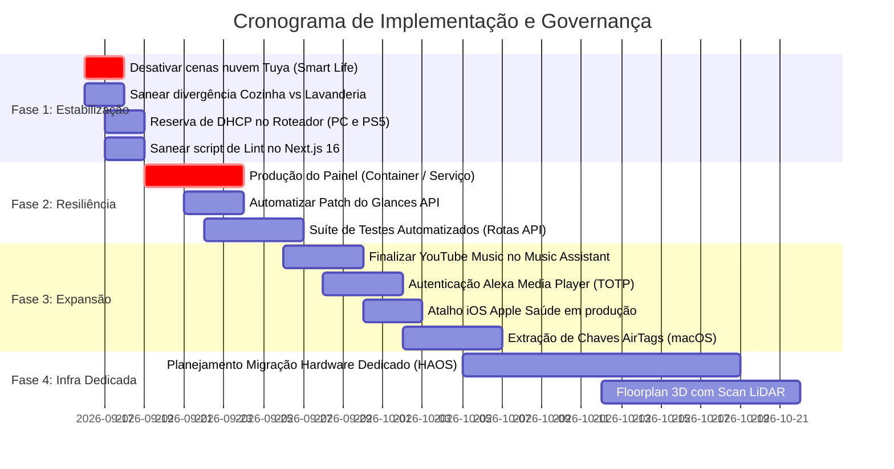

# Roteiro Recomendado de Evolução e Governança (Recommended Roadmap)

Data de Emissão: 15/09/2026  
Status: Proposto para Aprovação do Proprietário  
Escopo: Infraestrutura Home Assistant, Automações Físicas e Painel Visual Next.js

---

## 1. Visão Geral e Diretrizes Estratégicas

Com a desativação da dashboard Lovelace "Casa" em 15/09/2026 e a eleição do `dashboard-app` (Next.js 16 + React 19) como a interface canônica da residência, o projeto entra em uma fase de **estabilização de infraestrutura e governança multi-agente**.

O objetivo deste roadmap é estruturar a transição técnica em 4 fases sequenciais, garantindo:
1. **Segurança Operacional**: Zero risco de corrupção de registros elétricos e eliminação de comportamentos fantasmas (luzes acendendo sozinhas).
2. **Resiliência 24/7**: Painel operando ininterruptamente no tablet de parede sem dependência de terminais manuais.
3. **Divisão de Trabalho Precisa**: Tarefas claramente delegadas entre **Antigravity** (Frontend / UX / Design System Liquid Glass) e **Claude Code** (Backend HA / Docker / Automações / Python).

---

## 2. Cronograma de Fases



---

## 3. Detalhamento das Fases

### Fase 1: Estabilização Crítica e Governança Imediata (Semana 1)
*Foco: Eliminar comportamentos erráticos imediatos e blindar a camada de dados.*

| ID | Ação Recomendada | Agente Executor | Impacto / Risco Mitigado |
| :--- | :--- | :--- | :--- |
| **F1.1** | **Expurgar Cenas Conflitantes na Nuvem Tuya (Smart Life)**<br>Desativar as rotinas `scene.lavanderia_em_uso`, `scene.lavanderia_vazia`, `scene.banheiro_em_uso` e `scene.banheiro_vazio` diretamente no app móvel Smart Life. | **Proprietário** | Elimina a concorrência que faz luzes acenderem e apagarem sozinhas sem passar pelo Home Assistant (**RSK-02**). |
| **F1.2** | **Alinhamento Canônico Cozinha vs Lavanderia**<br>Auditar e padronizar as referências de teclas em `CASA.md`, `config/automations.yaml`, `config/template_sensors.yaml` e `dashboard-app/lib/rooms.ts`. Tecla 1 = Cozinha; Tecla 2 = Copa; Tecla 3 = Lavanderia. | **Claude Code** (com revisão de **Antigravity**) | Previne inversão de estados físicos e disparos de automações no cômodo errado (**RSK-03**). |
| **F1.3** | **Fixação de Endereços IP por Reserva de DHCP**<br>Configurar reserva estática de DHCP no roteador da residência para o Host PC (`192.168.31.22`) e PlayStation 5. | **Proprietário** | Evita quebra de comunicação do Music Assistant e webhooks móveis (**RSK-08**). |
| **F1.4** | **Adequação do Script de Lint e Typecheck do Dashboard**<br>Ajustar `dashboard-app/package.json` para suportar as especificações do Next.js 16 (`eslint .` ou `next lint` configurado), garantindo validação de código em pipelines. | **Antigravity** | Habilita checagem estática confiável para agentes automatizados (**RSK-09**). |

---

### Fase 2: Robustez de Operação e Resiliência Contínua (Semanas 2 a 3)
*Foco: Garantir que o painel e os serviços sobrevivam a reboots e operem em nível industrial.*

| ID | Ação Recomendada | Agente Executor | Impacto / Risco Mitigado |
| :--- | :--- | :--- | :--- |
| **F2.1** | **Transição do Painel para Execução em Produção**<br>Compilar o painel com `next build` e encapsulá-lo em container Docker (`painel-casa` na rede `casa-net`) ou registrá-lo como Tarefa Agendada do Windows no logon, aposentando a dependência do servidor interativo de desenvolvimento. | **Claude Code** + **Antigravity** | Elimina quedas do painel quando o terminal do Windows é fechado e melhora a velocidade de carregamento em tablets (**RSK-08**). |
| **F2.2** | **Script de Reaplicação Automática do Patch Glances**<br>Criar rotina no script de inicialização do Docker para reaplicar o patch de timeout (`timeout=15`) em `glances_api` sempre que o container for recriado. | **Claude Code** | Garante persistência dos dados de telemetria da máquina host (**RSK-06**). |
| **F2.3** | **Implementação de Suíte de Testes Automatizados**<br>Instalar testes de API (Vitest/Playwright) em `dashboard-app` validando as respostas de `/api/state`, `/api/toggle`, `/api/control` e o parsing de `rooms.ts`. | **Antigravity** | Protege o painel contra regressões silenciosas de tipagem ou quebra de endpoints (**RSK-10**). |
| **F2.4** | **Rotina Defensiva contra Injeção de `desktop.ini`**<br>Consolidar no build do Next.js e nos scripts PowerShell a remoção cirúrgica de arquivos `desktop.ini` injetados pela sincronização em nuvem do Google Drive. | **Antigravity** | Evita corrupção do cache `.next` e erros do compilador Turbopack (**RSK-07**). |

---

### Fase 3: Expansão de Integrações e Som Multiroom (Semanas 4 a 6)
*Foco: Integrar serviços pendentes e enriquecer as capacidades multimídia e de presença.*

| ID | Ação Recomendada | Agente Executor | Impacto / Risco Mitigado |
| :--- | :--- | :--- | :--- |
| **F3.1** | **Ativação do YouTube Music no Music Assistant**<br>Executar `scripts/music_assistant/ytmusic_setup.js` fornecendo os cookies de sessão Google/YouTube para habilitar o provedor beta de streaming de música. | **Proprietário** + **Claude Code** | Expande a biblioteca de áudio residencial para além das mídias locais. |
| **F3.2** | **Desbloqueio do Alexa Media Player**<br>Configurar senha direta e autenticação de dois fatores por aplicativo (TOTP/App Autenticador) na Amazon Brasil, contornando a incompatibilidade de passkey com proxy local. | **Proprietário** + **Claude Code** | Habilita comandos de voz, anúncios TTS em Echo e controle de dispositivos Alexa. |
| **F3.3** | **Ativação Diária da Telemetria Apple Saúde**<br>Configurar a automação do app Atalhos no iPhone do proprietário para despachar passos, calorias, sono e frequência cardíaca para o webhook `/api/webhook/<saude>`. | **Proprietário** | Alimenta em tempo real o widget de saúde do dashboard sem dados sintéticos de teste. |
| **F3.4** | **Provisionamento de Chaves dos AirTags (FindMy)**<br>Utilizar um computador Mac temporário para executar `python3 -m findmy decrypt` e carregar os arquivos JSON de chaves criptográficas no servidor Anisette local. | **Proprietário** + **Claude Code** | Habilita rastreamento de AirTags no mapa e cartões de presença residencial. |

---

### Fase 4: Arquitetura Definitiva em Hardware Dedicado (Médio Prazo)
*Foco: Libertar a automação residencial da dependência do PC pessoal Windows.*

| ID | Ação Recomendada | Agente Executor | Impacto / Risco Mitigado |
| :--- | :--- | :--- | :--- |
| **F4.1** | **Migração para Host Dedicado (Home Assistant OS)**<br>Migrar a stack de containers para um Mini PC (ex: N100) ou Raspberry Pi 4/5 com Home Assistant OS bare-metal. | **Proprietário** + **Claude Code** | **Resolve RSK-05 definitivamente**: libera suporte a multicast (mDNS, AirPlay, Chromecast, Spotify Connect) e impede queda do sistema ao desligar o PC. |
| **F4.2** | **Mapeamento 3D da Residência (LiDAR / Floorplan)**<br>Realizar escaneamento dos cômodos via sensor LiDAR do iPad e integrar a representação geométrica tridimensional ao painel visual. | **Proprietário** + **Antigravity** | Concretiza a visão original de planta dinâmica interativa com iluminação fotorrealista. |

---

## 4. Matriz de Atribuição e SLA de Governança

Para manter a harmonia operacional entre as ferramentas de inteligência artificial:

```
                  ┌─────────────────────────────────────┐
                  │       Proprietário (André)          │
                  │   Decisões, Segredos, Credenciais   │
                  └──────────────────┬──────────────────┘
                                     │
           ┌─────────────────────────┴─────────────────────────┐
           ▼                                                   ▼
┌───────────────────────┐                           ┌───────────────────────┐
│     Claude Code       │                           │      Antigravity      │
│  - Docker / Sistema   │                           │  - Next.js / React 19 │
│  - config/automations │◄────── [Contrato Canônico]───────►│  - Liquid Glass UI    │
│  - template_sensors   │     lib/rooms.ts          │  - Widgets / Modais   │
│  - scripts/diagnostico│     manifesto-comodos.json│  - Acessibilidade     │
└───────────────────────┘                           └───────────────────────┘
```

1. **Alterações em `lib/rooms.ts`**: Requerem validação prévia de entidades ativas no Home Assistant (`GET /api/states`).
2. **Alterações em `config/automations.yaml`**: Devem sempre incluir justificativas arquiteturais na chave `description`.
3. **Edições em arquivos `.storage/`**: Obrigatoriamente precedidas de backup em `backups/` e execução de `docker stop homeassistant`.
4. **Commits em `dashboard-app`**: Manter convenção Conventional Commits (`feat:`, `fix:`, `chore:`, `refactor:`).
